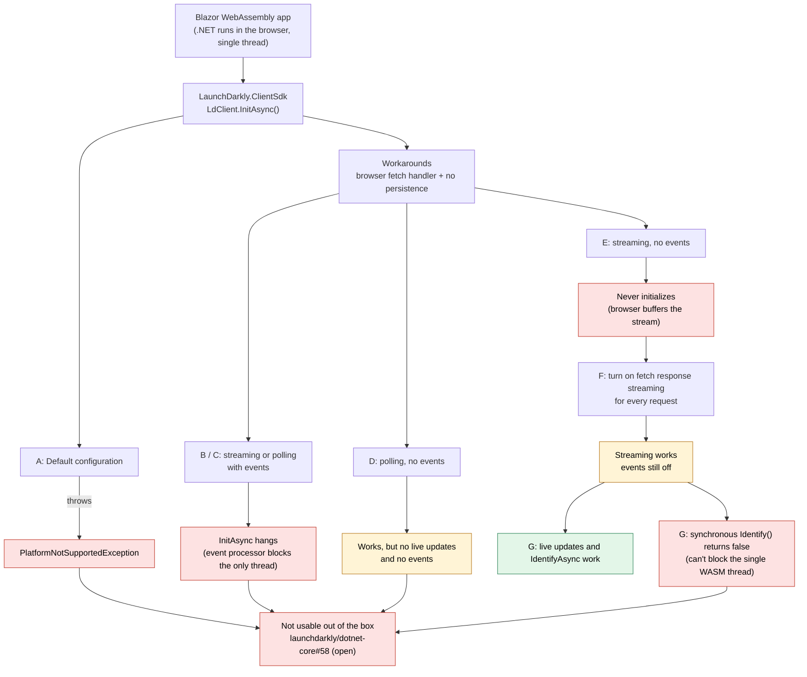
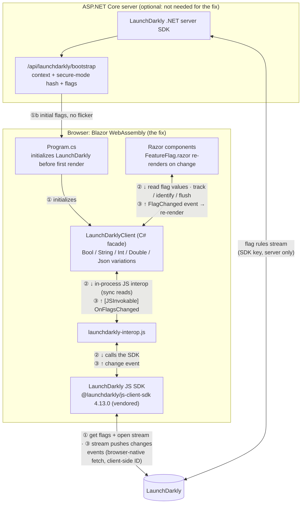

# LaunchDarkly in Blazor WebAssembly

## 1. Today: the .NET client-side SDK inside Blazor WebAssembly

*Diagram not showing? Open the image: [diagram-1-dotnet-client-sdk.png](diagram-1-dotnet-client-sdk.png)*

**Best case (F/G):** streaming flags with **events off**: no analytics, metrics, experiments or guarded rollouts, and async-only identify.

## 2. Proposed: LaunchDarkly's JavaScript SDK behind a C# facade

*Diagram not showing? Open the image: [diagram-2-js-sdk-facade.png](diagram-2-js-sdk-facade.png)*

**Step-by-step views.** The numbers match the phase diagrams in `before-after.html`:

| Label | Phase | What happens |
|---|---|---|
| **①** | Client Phase 1 · Startup | The app sets up LaunchDarkly before showing anything. The JS SDK gets flag values and opens the stream. |
| **①b** | Client Phase 1b · Startup with server bootstrap (optional) | The server evaluates the flags and the hash first, so the browser starts with correct values. |
| **②** | Client Phase 2 · First render | A component reads a flag. The ↓ arrows return a value from memory, with no network call. |
| **③** | Client Phase 3 · A flag changes | LaunchDarkly pushes the change. The ↑ arrows carry it to C#, and the page re-renders. |
| Server line | Server Phases 1–3 | The server SDK downloads the flag rules, evaluates them in memory per request, and updates them when they change. |

| Why it works | |
|---|---|
| **Built for the browser** | The JS SDK already handles fetch, streaming, events and flushing on page close. None of the .NET workarounds are needed. |
| **Nothing blocks the thread** | Flag reads are synchronous in-process interop. Identify, track and flush are async. |
| **Live updates reach the UI** | The JS SDK's change event calls into C#, and components re-render. |
| **No flicker, no secrets in the browser** | The server pre-evaluates flags and computes the secure-mode hash. The SDK key never leaves the server. |
| **Swappable later** | Components depend only on the C# interface. A native .NET SDK could replace the JS SDK later without changing components. |
